# SolaX service architecture

This document describes the responsibilities visible in the current implementation. The process entry points are `app.solax.backend.polling.solax_service` and `app.solax.backend.services.control_service`; the older `app.solax.backend.services.solax_service` module is a compatibility entry point. Both services share the configured SQLite database, but only the control path is given a write-capable Modbus service.

## Components

- **Monitoring poller** (`backend.polling.solax_service`) calls `InverterPollingService` for local Modbus telemetry and mode registers, saves successful snapshots and a poller heartbeat, and sends work-mode/outage notifications. When local reads fail it may save a SolaX cloud snapshot for monitoring; cloud samples are explicitly separate from current local control telemetry. The poller has no inverter write path.
- **Control service** (`backend.services.control_service`) obtains a fresh local snapshot before evaluating schedules, Smart Flex and reconciliation. It reads persisted Octopus/vehicle data as external inputs, records its own heartbeat, and suspends evaluation after an unsafe or failed local poll. Its `_ControlInverterAdapter` exposes the polling service for reads and a separate `SolaxModbusService` for writes.
- **Modbus communication** (`telemetry.modbus_client`, `telemetry.modbus_service`) reads the configured input and holding registers, decodes signed power values, and builds `PowerFlowSnapshot`. `SolaxModbusService.write_work_mode` writes the existing work/manual write registers only when `DRY_RUN` is false. In the current configuration `DRY_RUN = True`, so it logs the requested values and returns without sending writes. No other component is directly given the write service by the production control composition.
- **Telemetry storage** (`storage.solax_repository`, backend storage repositories and `backend.storage.schema`) persists snapshots, aggregate tables and heartbeats in SQLite. Local Modbus and cloud monitoring snapshots are kept in separate tables/source-labelled records. Aggregation reads stored samples and writes derived time buckets; it does not contact the inverter.
- **Inverter state management** (`backend.automation.inverter_state_repository`; compatibility helpers in `storage.inverter_state`) stores a singleton desired-state request. It records requested work/manual modes, the source owner, lifecycle phase, underlying request and restoration target. SQLite commits make the intent durable across process restarts; the row is not a measurement of actual inverter state.
- **Scheduler** (`backend.automation.scheduler`) reads enabled schedule periods and compares their local wall-clock windows. On entry/exit it sets, updates or restores the desired request. When Smart Flex owns the top-level request, scheduler changes are saved as the underlying request for later restoration.
- **Smart Flex controller and orchestrator** (`backend.smart_flex.smart_flex_controller`, `backend.automation.smart_flex_orchestrator`) evaluate dispatch timing, vehicle charging state and battery SOC, then manage a Force Charge request. The control service validates persisted dispatch freshness and the Octopus heartbeat before treating an empty dispatch result as authoritative. Missing, stale or failed dispatch data leaves an active Smart Flex request latched; fresh valid empty data establishes that no planned dispatch remains. Vehicle status is required to start a new request, while an already-active slot remains owned during a temporary vehicle-status gap.
- **Inverter reconciler** (`backend.inverter.inverter_reconciler`) compares the current durable request with the fresh local snapshot, applies retry/backoff rules, delegates a requested mode write, and waits for later telemetry to confirm the change before advancing/clearing the request. It does not poll, schedule or fetch external inputs.
- **Service heartbeats** (`backend.storage.service_heartbeat_repository`, `backend.polling.solax_service`, `backend.services.control_service`) record process liveness and status in the shared database. Consumers use heartbeat age to distinguish current external data from an absent or stale service; a heartbeat is not proof of a successful inverter write.

## Data and control flow

```mermaid
flowchart LR
    INV["SolaX inverter / Modbus dongle"]
    MB["Modbus read layer"]
    POLL["Monitoring poller"]
    DB[("Shared SQLite database")]
    CTRL["Control service"]
    SCHED["Scheduler"]
    FLEX["Smart Flex controller + orchestrator"]
    STATE["Inverter state repository"]
    REC["Inverter reconciler"]
    WRITE["Guarded Modbus write service"]
    OCT["Octopus dispatch, vehicle status and heartbeat"]
    CLOUD["SolaX cloud API (monitoring fallback)"]

    INV -->|register reads| MB --> POLL
    POLL -->|telemetry + poller heartbeat| DB
    POLL -. local read failure only .-> CLOUD
    CLOUD -. cloud telemetry for monitoring .-> DB
    DB -->|fresh local telemetry and persisted state| CTRL
    DB -->|schedule periods| SCHED
    CTRL --> SCHED --> STATE
    DB -->|validated external inputs| CTRL
    OCT -->|persisted data| DB
    CTRL --> FLEX --> STATE
    CTRL --> REC
    STATE -->|desired request| REC
    REC -->|requested mode pair| WRITE
    WRITE -->|write only when DRY_RUN is false| INV
    INV -->|later telemetry confirmation| MB
    MB --> POLL
    CTRL -->|control heartbeat| DB
```

Only the control service's reconciler is wired to the write-capable Modbus service in the current production composition. The poller and cloud API are monitoring-only. The low-level Modbus service still contains the guarded write method, so code that independently constructs it could call that method; the DRY_RUN interlock is the final configured safeguard.

## Configuration and path assumptions

`app/config/solax_config.py` defines the main poller/control host and port, poll and freshness intervals, communication-loss threshold, Smart Flex SOC target, register offsets/addresses and `DRY_RUN`. Modbus device ID is supplied by the `slave_id` constructor argument (default 1), not by this settings module. Telemetry read addresses and write addresses are deliberately separate: input telemetry includes offsets in the 0–79 block, work/manual mode reads use holding registers `0x008B`/`0x008C`, and writes use configured addresses 31/32. Do not infer that a read address is a write address.

`app/config/project_paths.py` resolves the shared data, log and SQLite paths. `ENERGY_DASHBOARD_DB` selects an explicit database file; `ENERGY_DASHBOARD_DATA_DIR` selects the directory and, absent an explicit DB path, the `energy_dashboard.db` file within it; `ENERGY_DASHBOARD_LOG_DIR` selects the log directory. Without overrides, the new data default is `<project root>/data/energy_dashboard.db`; an existing legacy database is reused when it is the sole candidate. If both legacy and new candidates exist, resolution raises rather than silently splitting state. The known Windows legacy candidate is under the user home directory at `OffLine Documents/EnergyDashboard/data/energy_dashboard.db`; the Linux legacy candidate is `<project root>/app/data/energy_dashboard.db`. When deploying on another host, set an explicit DB path if the existing database location is not the expected candidate. Environment values are paths and should not contain credentials.

The separate `app/solax/telemetry/config.py` values configure the standalone register scanner, not the production poller loop. `backend.storage.schema_old` and older storage/repository modules remain in the tree; their active runtime use is not established here and should be checked at call sites before relying on them.

## Lifecycle and failure boundaries

The control loop first obtains local Modbus data and rejects missing, stale or future-dated control-critical fields. It then updates scheduled intent, evaluates Smart Flex only with valid external dispatch data, and invokes reconciliation. Invalid local telemetry prevents the control cycle from proceeding. Invalid external dispatch data prevents a Smart Flex start or end decision based on that data, so an active request is not restored merely because a query returned no rows after an error. Successful writes are not treated as confirmed state until a subsequent poll reports the requested register values.
